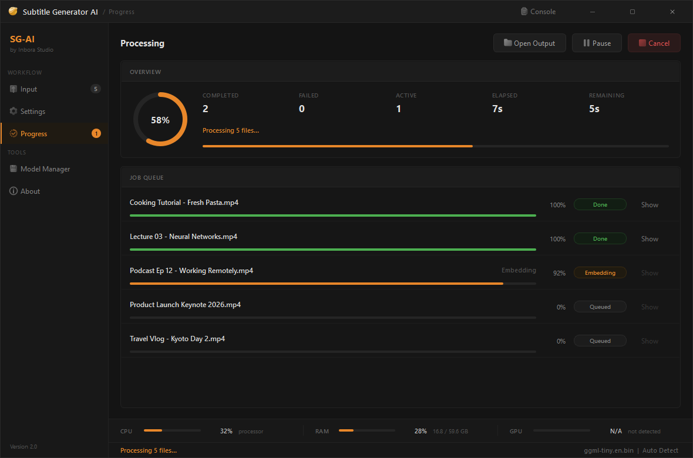
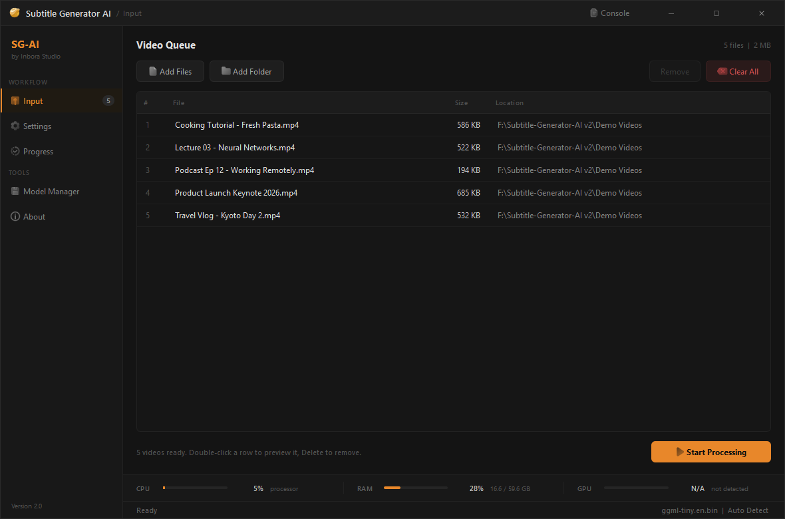
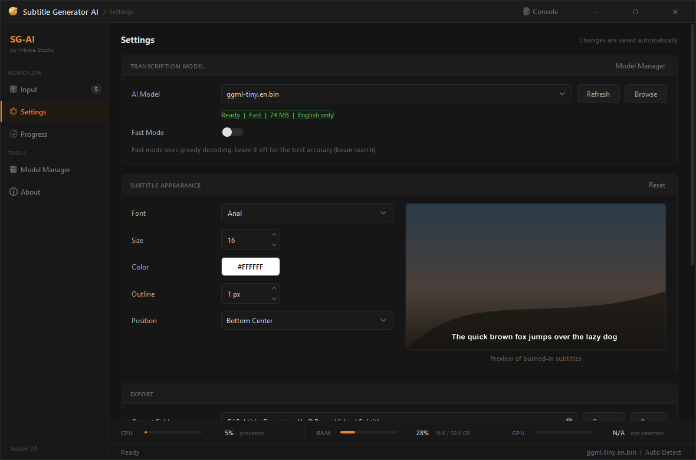
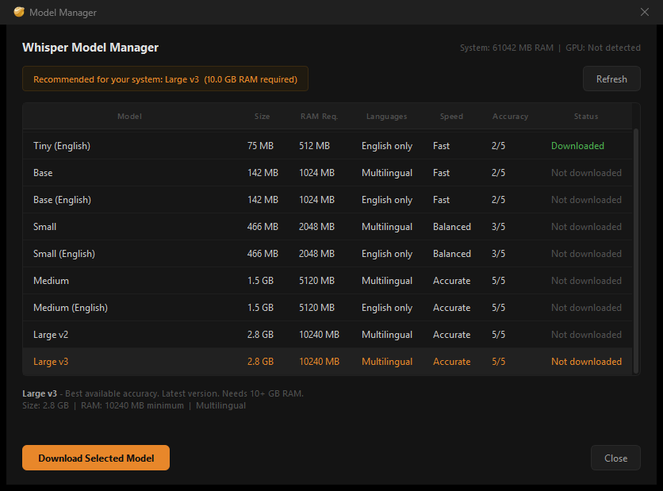
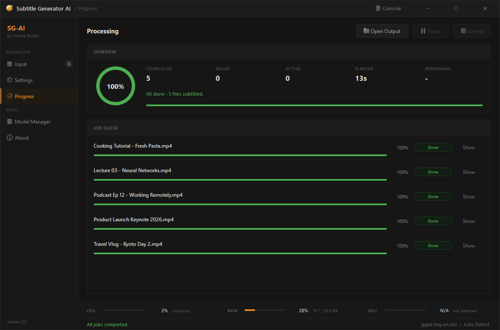
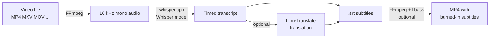

<div align="center">


# Subtitle Generator AI

### Free offline AI subtitle generator for Windows, macOS and Linux  powered by OpenAI Whisper

**Turn any video into accurate subtitles (SRT) or burned-in captions with one click.<br/>
100% local: no cloud, no account, no upload, no subscription.**

[](https://github.com/InboraStudio/Subtitle-Generator-AI/releases/latest)
[](https://github.com/InboraStudio/Subtitle-Generator-AI/releases/latest)
[](https://github.com/InboraStudio/Subtitle-Generator-AI/releases)
[](https://discord.gg/pVA8NZ5mru)

[](#download)
[](https://github.com/ggml-org/whisper.cpp)
[](#build-from-source)
[](#gpu-acceleration)

<br/>



<sub>Batch subtitling five videos on a laptop CPU  everything runs on your own machine.</sub>

</div>

---

**Subtitle Generator AI** is a free desktop app that automatically creates subtitles for
video files using [OpenAI Whisper](https://github.com/openai/whisper) speech recognition,
running entirely on your own computer through
[whisper.cpp](https://github.com/ggml-org/whisper.cpp). Drop in videos, press **Start**,
and get time-synced `.srt` subtitle files  plus, if you want, a copy of each video with
the subtitles burned in. It supports **99 spoken languages**, processes **whole folders in
one batch**, and works **offline after a one-time model download**. Made by
[Inbora Studio](https://github.com/InboraStudio).

## Contents

- [Why Subtitle Generator AI](#why-subtitle-generator-ai)
- [Download](#download)
- [How to generate subtitles for a video](#how-to-generate-subtitles-for-a-video-in-3-steps)
- [Features](#features)
- [Screenshots](#screenshots)
- [Choosing a Whisper model](#choosing-a-whisper-model)
- [FAQ](#faq)
- [How it works](#how-it-works)
- [Build from source](#build-from-source)
- [Roadmap](#roadmap)
- [Community and support](#community-and-support)

## Why Subtitle Generator AI

| | Subtitle Generator AI | Typical online subtitle tools |
| :--- | :--- | :--- |
| **Privacy** | Video never leaves your PC | Video is uploaded to a server |
| **Cost** | Free, unlimited minutes | Often per-minute pricing or monthly plans |
| **Internet** | Only for the one-time model download | Required for every video |
| **Batch processing** | Whole folders, parallel jobs | Usually one file at a time |
| **Burned-in captions** | Built in, with live style preview | Often a separate paid step |
| **Accuracy** | Choose Whisper Tiny → Large v3 | Fixed by the service |

Ideal for **YouTubers, podcasters, educators, students, journalists, translators,
accessibility work** and anyone who needs captions for **sensitive or unpublished footage**
that must not be uploaded.

## Download

| Platform | File | Notes |
| :--- | :--- | :--- |
| **Windows 10 / 11 (64-bit)** | [`SubtitleGeneratorAI-Setup-<version>.exe`](https://github.com/InboraStudio/Subtitle-Generator-AI/releases/latest) | One-click installer. No admin rights needed. |
| Windows (no install) | [`SubtitleGeneratorAI-Windows-<version>-portable.zip`](https://github.com/InboraStudio/Subtitle-Generator-AI/releases/latest) | Unzip anywhere and run `SubtitleGeneratorAI.exe`. |
| macOS (Apple Silicon / Intel) | [`.dmg`](https://github.com/InboraStudio/Subtitle-Generator-AI/releases/latest) | Metal GPU acceleration on Apple Silicon. |
| Linux (x86-64) | [`.AppImage`](https://github.com/InboraStudio/Subtitle-Generator-AI/releases/latest) | `chmod +x` and run. |

**Nothing else to install.** The Windows installer bundles the Whisper engine, FFmpeg and
every runtime library, so there are no "missing DLL" errors and no FFmpeg setup. On first
launch the app offers to download a Whisper model sized for your PC; after that it works
fully offline.

## How to generate subtitles for a video in 3 steps

1. **Install and open** Subtitle Generator AI. On first launch, click **Choose a Model** and
   download the model the Model Manager recommends for your PC (one-time).
2. **Add videos**  drag and drop files or whole folders onto the window, or use
   **Add Files / Add Folder**. You can also drop videos straight onto the app's desktop
   icon.
3. **Press Start Processing.** Each video gets a `.srt` subtitle file in your output folder,
   and (optionally) a `<name>_subbed.mp4` copy with the subtitles burned in.

That's it  open the `.srt` in any video player (VLC, MPC-HC, mpv, Windows Media Player),
upload it to YouTube, or import it into Premiere Pro, DaVinci Resolve or CapCut.

## Features

**Transcription**
- **Automatic speech-to-text** with OpenAI Whisper, from Tiny (fast) to Large v3 (most accurate)
-  **99 spoken languages** with automatic language detection
-  **Fast mode** (greedy decoding) or **accurate mode** (beam search)
-  **GPU acceleration**: NVIDIA (CUDA), AMD (ROCm/HIP or Vulkan), Intel (Vulkan), Apple Silicon (Metal)  or CPU only

**Workflow**
-  **Batch processing**: queue hundreds of videos, scan folders recursively, run several jobs in parallel
-  **Pause, resume and cancel** a batch; live progress, elapsed time and ETA per batch
-  Works with **MP4, MKV, AVI, MOV, WEBM, FLV, WMV, M4V, TS, MTS, M2TS, MPG, MPEG**
-  **Model Manager** recommends the best Whisper model for your RAM and downloads it in one click

**Output**
-  **SRT subtitle files** with accurate timestamps, ready for YouTube and any editor
-  **Burned-in (hardcoded) subtitles** exported as MP4 (H.264 + AAC)
-  **Subtitle styling**  font, size, colour, outline and position  with a **live preview**
-  **Optional translation** into 24 languages through a self-hosted [LibreTranslate](https://github.com/LibreTranslate/LibreTranslate) server

**Desktop app**
-  **100% offline and private**  no telemetry, no account, no cloud
-  Clean dark interface with live CPU / RAM / GPU usage and a filterable log console
-  Remembers all settings, window size and position between sessions
-  Keyboard shortcuts for everything (see [FAQ](#are-there-keyboard-shortcuts))

## Screenshots

<table>
<tr>
<td width="50%"><br/><b>Video queue</b> — drop files or whole folders.</td>
<td width="50%"><br/><b>Settings</b> — model, subtitle style with live preview, export and translation.</td>
</tr>
<tr>
<td width="50%"><br/><b>Model Manager</b> — recommends a Whisper model for your RAM.</td>
<td width="50%"><br/><b>Done</b> — open the output folder straight from each row.</td>
</tr>
</table>

**Burned-in subtitles** produced by the app (white text, black outline, bottom centre):


**The generated `.srt` file** for that video:

```srt
1
00:00:00,000 --> 00:00:04,020
Good morning everyone, and thank you for joining us.

2
00:00:04,020 --> 00:00:11,460
Today we are introducing a faster, simpler way to create subtitles for every video you publish.

3
00:00:11,460 --> 00:00:16,000
It works offline, it is free, and it takes a single click.
```

## Choosing a Whisper model

Download models from the in-app **Model Manager**; it highlights the recommended one for
your PC. Bigger models are more accurate but slower and need more memory.

| Model | Download | RAM needed | Languages | Best for |
| :--- | ---: | ---: | :--- | :--- |
| Tiny / Tiny (English) | 75 MB | ~0.5 GB | 99 / English | Quick drafts, very old PCs |
| Base / Base (English) | 142 MB | ~1 GB | 99 / English | Fast everyday English captions |
| Small / Small (English) | 466 MB | ~2 GB | 99 / English | Good balance of speed and accuracy |
| Medium / Medium (English) | 1.5 GB | ~5 GB | 99 / English | High accuracy, accents, noisy audio |
| Large v2 | 2.8 GB | ~10 GB | 99 | Very high accuracy |
| **Large v3** | 2.8 GB | ~10 GB | 99 | **Best accuracy**, especially non-English |

> **Tip:** the `(English)` models are faster and slightly more accurate for English-only
> videos. For any other language, use a multilingual model.

Models are stored outside the app, so updates and reinstalls keep them:
`%LOCALAPPDATA%\SubtitleGeneratorAI\models` (Windows),
`~/Library/Application Support/SubtitleGeneratorAI/models` (macOS),
`~/.local/share/SubtitleGeneratorAI/models` (Linux).

## FAQ

### How do I generate subtitles for a video for free, without uploading it?
Install Subtitle Generator AI, download a Whisper model once from the Model Manager, add
your videos and press **Start Processing**. Transcription runs locally with whisper.cpp,
so the video never leaves your computer and there is no usage limit or fee.

### Does it work offline?
Yes. Internet is only used to download a Whisper model the first time (and optionally to
check for updates). After that, transcription, subtitle export and burning captions into
video all work with no connection.

### Is it really free?
Yes. There are no accounts, subscriptions, watermarks or per-minute limits.

### Which languages does it support?
Whisper recognises **99 spoken languages**, including English, Spanish, French, German,
Hindi, Arabic, Chinese, Japanese, Korean, Portuguese, Russian, Indonesian and Turkish.
Leave the language on **Auto Detect** or pick it in Settings. Optional translation of the
subtitles into 24 languages is available through a self-hosted LibreTranslate server.

### What subtitle formats does it create?
It writes standard **SubRip (`.srt`)** files, which work with YouTube, VLC, Premiere Pro,
DaVinci Resolve, Final Cut (via import), CapCut and almost every player. It can also export
an **MP4 with hardcoded (burned-in) subtitles** for social media, where soft subtitles are
often not supported.

### How accurate is it?
Accuracy depends on the model and the audio. Large v3 is very accurate on clear speech; Small and Medium are a good balance on most PCs; Tiny and Base are fast but
make more mistakes with names, accents and background noise. You can always edit the
`.srt` in any text editor.

### How fast is it? Do I need a GPU?
No GPU is required. On a modern CPU, small models transcribe faster than real time; the
demo above (five short clips, Tiny model) finished in 13 seconds including burning in the
subtitles. A GPU (NVIDIA, AMD, Intel or Apple Silicon) makes the large models much faster.

### Can I subtitle many videos at once?
Yes. Add files or whole folders (subfolders are scanned too), then press Start. Increase
**Parallel Jobs** in Settings to process several videos at the same time if you have
enough RAM. You can pause, resume or cancel the batch at any time.

### Can I change how burned-in subtitles look?
Yes. In **Settings → Subtitle Appearance** choose the font, size, colour, outline thickness
and position (nine positions). The preview next to the controls shows exactly how the
captions will be rendered.

### Is it a good alternative to paid or cloud subtitle services?
For most videos, yes: it runs OpenAI's open Whisper speech-recognition models locally,
for free and without limits, and keeps your footage private. Cloud tools can still be handy
for collaborative editing in a browser.

### Are there keyboard shortcuts?
| Shortcut | Action |
| :--- | :--- |
| `Ctrl+O` / `Ctrl+Shift+O` | Add files / add a folder |
| `Ctrl+Enter` | Start processing |
| `Ctrl+1` / `Ctrl+2` / `Ctrl+3` | Input / Settings / Progress page |
| `Ctrl+M` | Open the Model Manager |
| ``Ctrl+` `` | Show or hide the log console |
| `Delete` | Remove selected files from the queue |
| `F11` | Maximise / restore the window |

### Where are my settings and logs?
Settings are saved automatically (Windows registry under
`HKCU\Software\SubtitleGeneratorAI`). Logs are in
`%LOCALAPPDATA%\SubtitleGeneratorAI\SubtitleGeneratorAI\logs` on Windows; you can also view,
filter, copy and save them from the in-app **Console**.

### Windows SmartScreen warns about the installer. Is it safe?
New, unsigned apps can trigger SmartScreen until they build up reputation. Click
**More info → Run anyway**. You can verify the download against `SHA256SUMS.txt` attached to
every release, or build the app yourself from this repository.

## How it works



- **Audio extraction:** FFmpeg decodes the video's audio track to 16 kHz mono PCM.
- **Speech recognition:** [whisper.cpp](https://github.com/ggml-org/whisper.cpp), a C/C++
  port of OpenAI Whisper, runs the selected model on the CPU or GPU (via ggml).
- **Subtitles:** segments with start/end timestamps are written as SubRip `.srt`.
- **Burn-in:** FFmpeg's `subtitles` filter (libass) renders the captions with your style
  and re-encodes the video as H.264/AAC MP4.
- **App:** native C++17 with Qt 6  a small, fast desktop app with no Python, Electron
  or browser runtime.

## Build from source

<details>
<summary><b>Requirements</b></summary>

- CMake 3.25+
- A C++17 compiler: GCC 13+, Clang 15+ or MSVC 2022
- Qt 6.8+ (Widgets, Core, Concurrent, Network)
- FFmpeg at runtime (bundled automatically in Windows release builds)
- whisper.cpp is pinned as `third_party/whisper.cpp`; release scripts fetch the exact commit

</details>

```bash
git clone https://github.com/InboraStudio/Subtitle-Generator-AI.git
cd Subtitle-Generator-AI
```

<details>
<summary><b>Windows (MSYS2 UCRT64)  one-step installer build</b></summary>

Install [MSYS2](https://www.msys2.org) and [Inno Setup 6](https://jrsoftware.org/isdl.php), then in a UCRT64 shell:

```bash
pacman -S mingw-w64-ucrt-x86_64-toolchain mingw-w64-ucrt-x86_64-cmake \
          mingw-w64-ucrt-x86_64-ninja mingw-w64-ucrt-x86_64-qt6-base \
          mingw-w64-ucrt-x86_64-qt6-tools
```

Double-click **`build_installer.bat`** (or run `bash scripts/package-windows.sh`). It fetches
the pinned whisper.cpp, builds a release, bundles Qt, the runtime and FFmpeg, verifies that
no DLL is missing on a clean PC, and writes the installer and portable zip to `dist\`.

For a quick development build instead:

```bash
cmake -S . -B build -G Ninja -DCMAKE_BUILD_TYPE=Release
cmake --build build -j
./deploy.sh            # copy Qt + runtime DLLs next to the exe
```

> **"The procedure entry point `qResourceFeatureZstd` could not be located"** means a
> different `Qt6Core.dll` was picked up from `PATH`. Run `./deploy.sh` so the exe ships
> with its own matching DLLs.

</details>

<details>
<summary><b>Linux</b></summary>

```bash
# Arch / CachyOS
sudo pacman -S base-devel cmake ninja qt6-base ffmpeg
# Debian / Ubuntu
sudo apt install build-essential cmake ninja-build qt6-base-dev ffmpeg
# Fedora
sudo dnf install gcc-c++ cmake ninja-build qt6-qtbase-devel ffmpeg

cmake -S . -B build -G Ninja -DCMAKE_BUILD_TYPE=Release
cmake --build build -j
./build/bin/SubtitleGeneratorAI
```

For a Vulkan build, also install the Vulkan headers, loader, SPIR-V headers and `glslc`
(e.g. `vulkan-headers spirv-headers shaderc vulkan-icd-loader` on Arch,
`libvulkan-dev spirv-headers glslc` on Debian/Ubuntu) and add `-DGPU_BACKEND=vulkan`.

</details>

<details>
<summary><b>macOS (Apple Silicon or Intel)</b></summary>

```bash
make deps      # brew install cmake ninja qt ffmpeg
make           # fetches the pinned whisper.cpp, configures and builds
make run
```

The `Makefile` builds for the machine's native architecture (arm64 on Apple Silicon, even
from a Rosetta terminal). `make doctor` prints the detected toolchain. Metal GPU
acceleration is enabled automatically.

</details>

### GPU acceleration

Inference runs on the CPU by default. Choose a GPU backend when configuring:

| `-DGPU_BACKEND=` | Hardware | Extra build dependencies |
| :--- | :--- | :--- |
| `none` *(default)* | CPU only | — |
| `vulkan` | AMD, Intel, NVIDIA | Vulkan headers + loader, `glslc`, SPIR-V headers |
| `cuda` | NVIDIA | CUDA Toolkit |
| `hip` | AMD (ROCm) | ROCm / HIP toolchain |

On macOS, Metal is enabled automatically  leave `GPU_BACKEND` at `none`. Vulkan is the
recommended choice for AMD and Intel GPUs: no vendor SDK, and recent hardware gets
cooperative-matrix (tensor core) kernels through ggml.

### Making a release

Push a version tag and GitHub Actions builds the Windows installer, portable zip, Linux
AppImage and macOS DMGs, then publishes them with checksums:

```bash
git tag v2.1.0
git push origin v2.1.0
```

## Roadmap

- [x] whisper.cpp integration with GPU backends (Vulkan, CUDA, ROCm, Metal)
- [x] Batch queue with parallel jobs, pause / resume / cancel
- [x] Burned-in subtitles with live style preview
- [x] One-click Windows installer with everything bundled
- [ ] More export formats (VTT, ASS) and a built-in subtitle editor
- [ ] Real-time microphone transcription
- [ ] Speaker diarization (who said what)

Have an idea? [Open an issue](https://github.com/InboraStudio/Subtitle-Generator-AI/issues) or tell us on Discord.

## Community and support

- **Discord:** [discord.gg/pVA8NZ5mru](https://discord.gg/pVA8NZ5mru)  help, feedback and new releases
- **Bugs and feature requests:** [GitHub Issues](https://github.com/InboraStudio/Subtitle-Generator-AI/issues)
- **Like the project?** Star the repo  it helps other people find a free, private subtitle generator.

## Credits

**Made by [Inbora Studio](https://github.com/InboraStudio) (Dr Chamyoung).**

Built on the shoulders of [OpenAI Whisper](https://github.com/openai/whisper),
[whisper.cpp / ggml](https://github.com/ggml-org/whisper.cpp), [Qt](https://www.qt.io) and
[FFmpeg](https://ffmpeg.org). Windows builds include FFmpeg from
[BtbN/FFmpeg-Builds](https://github.com/BtbN/FFmpeg-Builds) (GPL); its licence ships in the
app's `bin` folder.

<div align="center">
<sub>Subtitle Generator AI  free offline AI subtitle generator · automatic captions · speech to text · SRT generator · Whisper desktop app for Windows, macOS and Linux</sub>
</div>
